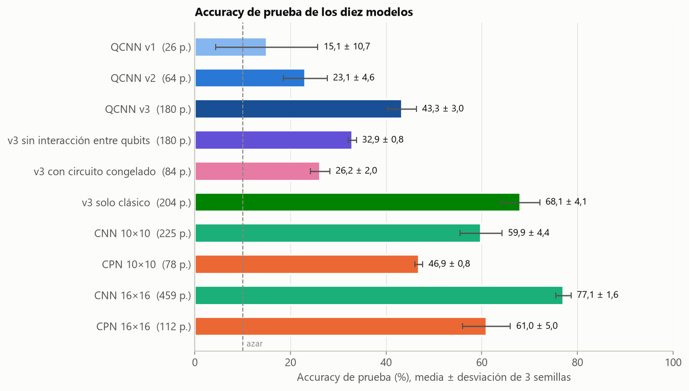
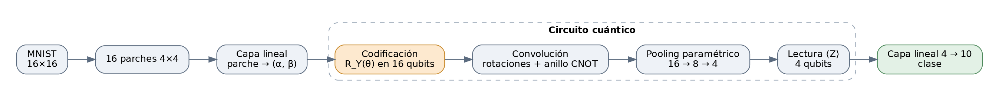
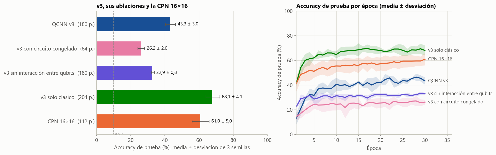

# QCNN MNIST

Estudio de una red convolucional cuántica híbrida (QCNN) sobre MNIST: cómo evoluciona la arquitectura en tres versiones y cuánto aporta realmente la parte cuántica frente a controles clásicos de tamaño parecido.

**Pregunta:** ¿cuánto aporta el circuito cuántico de una QCNN híbrida a la clasificación de MNIST, comparado con controles clásicos que ven los mismos datos?

**Respuesta corta:** la QCNN solo aprende de forma consistente cuando su lectura pasa a valores esperados ⟨Z⟩ con una capa lineal; ese cambio, por sí solo, explica la mejora, y escalar a 16 qubits no añade accuracy medible. En la versión de 16 qubits, entrenar el circuito aporta frente a un circuito aleatorio y la interacción entre qubits también, pero una simulación de campo medio sin entrelazamiento queda cerca, y una red clásica con la misma estructura piramidal y menos parámetros supera a todas, con una fracción mínima del cómputo. En este montaje no hay ventaja cuántica.

No se busca demostrar una ventaja cuántica: es un laboratorio con protocolo común, tres semillas por configuración y ablaciones.

## Resultados



Accuracy de prueba y de entrenamiento en %, media ± desviación estándar de 3 semillas. El cómputo es el total de las 3 semillas en la CPU de un portátil.

<!-- resultados:todos -->
| Modelo | Parámetros | Accuracy de prueba (%) | Accuracy de entrenamiento (%) | Cómputo (h) |
| --- | ---: | ---: | ---: | ---: |
| QCNN v1 | 26 | 15,1 ± 10,7 | 15,3 ± 10,4 | 0,06 |
| QCNN v2 | 64 | 23,1 ± 4,6 | 22,2 ± 4,3 | 0,07 |
| v2 con lectura ⟨Z⟩ | 114 | 44,7 ± 2,3 | 45,7 ± 2,9 | 0,09 |
| QCNN v3 | 180 | 43,3 ± 3,0 | 45,7 ± 1,9 | 5,43 |
| v3 con circuito congelado | 84 | 26,2 ± 2,0 | 26,5 ± 4,0 | 4,05 |
| v3 solo clásico | 204 | 68,1 ± 4,1 | 70,3 ± 0,6 | 0,01 |
| v3 en campo medio | 180 | 39,1 ± 3,9 | 40,3 ± 2,8 | 0,03 |
| v3 sin interacción entre qubits | 180 | 32,9 ± 0,8 | 33,3 ± 0,5 | 4,53 |
| CNN 10×10 | 225 | 59,9 ± 4,4 | 60,9 ± 4,3 | 0,01 |
| CPN 10×10 | 78 | 46,9 ± 0,8 | 46,9 ± 1,3 | 0,01 |
| CNN 16×16 | 459 | 77,1 ± 1,6 | 83,0 ± 1,7 | 0,01 |
| CPN 16×16 | 112 | 61,0 ± 5,0 | 60,4 ± 5,9 | 0,01 |
<!-- /resultados:todos -->

## Evolución de la arquitectura

Las tres versiones comparten la misma idea: traducir una CNN pequeña a una QCNN. Cada parche de la imagen se comprime con una capa lineal entrenable a un par de amplitudes $(\alpha, \beta)$ que se cargan en un qubit con $R_Y(\theta)$, $\theta = 2\operatorname{arctan2}(\beta, \alpha)$; después, capas de convolución (rotaciones + anillo de CNOT) y pooling reducen el número de qubits en pirámide.



| Versión | Qué cambia | Qué se observa | Notebook |
| --- | --- | --- | --- |
| **v1** | 10×10, parches 2×2 (10 de la banda central), 10 qubits, pirámide 10 → 8 → 4 con $R_Y$ y anillo de CNOT. Lectura por probabilidades: 16 estados de 4 qubits, los 10 primeros son las clases y los 6 sobrantes se penalizan (λ = 0,3) | La pérdida se queda cerca de −log(1/16), el valor de una distribución uniforme; la accuracy de prueba oscila entre épocas y varía mucho entre semillas | [01](notebooks/01_v1_lectura_por_probabilidades.ipynb) |
| **v2** | Rotaciones SU(2) generales, *data re-uploading*, bias de entrada entrenable y λ = 0,1; misma lectura | Mejora poco y sigue lejos de los controles: más expresividad no basta con esa lectura | [02](notebooks/02_v2_expresividad.ipynb) |
| v2 con lectura ⟨Z⟩ (ablación) | El circuito de v2 sin cambios; solo la lectura pasa a ⟨Z⟩ de los 4 qubits finales + capa lineal 4 → 10, sin penalización | Aprende de forma consistente y alcanza a v3: la lectura es el cambio decisivo | [03](notebooks/03_v3_lectura_clasica_16_qubits.ipynb) |
| **v3** | 16×16, parches 4×4 (los 16), 16 qubits, pirámide 16 → 8 → 4 con pooling paramétrico. Lectura ⟨Z⟩ de 4 qubits + capa lineal 4 → 10 | Queda al nivel de v2 con lectura ⟨Z⟩: ver más imagen con más qubits no se traduce en más accuracy. No sobreajusta, pero queda por debajo de la CPN 16×16 | [03](notebooks/03_v3_lectura_clasica_16_qubits.ipynb) |

v3 cambia varias cosas a la vez respecto de v2. La ablación de lectura las separa: primero cambia solo la lectura y después la escala (resolución, parches, qubits y pooling). Los controles clásicos, que no cambian de lectura, muestran cuánto aporta la escala a un modelo que sí la aprovecha:

<!-- resultados:v2_v3 -->
| Paso | Ganancia (puntos) | Qué cambia |
| --- | ---: | --- |
| QCNN v2 → v2 con lectura ⟨Z⟩ | +21,6 | solo la lectura (⟨Z⟩ + capa lineal) |
| v2 con lectura ⟨Z⟩ → QCNN v3 | -1,3 | resolución, parches, qubits y pooling |
| QCNN v2 → QCNN v3 | +20,3 | las dos cosas |
| CPN 10×10 → CPN 16×16 | +14,1 | resolución y parches |
| CNN 10×10 → CNN 16×16 | +17,2 | resolución y parches |
<!-- /resultados:v2_v3 -->

Toda la mejora de v2 a v3 aparece al cambiar la lectura; el paso de escala, que a los controles clásicos les da una ganancia clara, no mueve la accuracy de la QCNN más allá de la variación entre semillas.

### Controles clásicos

- **CNN:** un filtro del tamaño del parche con paso igual al parche (procesa los mismos parches que la QCNN), una capa densa del tamaño del número de qubits y la salida de 10 clases.
- **CPN** (*Classical Pyramid Network*): la misma topología que la QCNN sin estados cuánticos. Usa los mismos parches, cada convolución es $\tanh(x\,\theta)$ por posición, el pooling promedia pares y termina en 4 valores con la misma salida lineal 4 → 10. Es la comparación más directa con v3.

## ¿Qué aporta la parte cuántica?

v3 es híbrida: capa clásica de entrada, circuito, capa clásica de salida. Para saber cuánto del resultado se debe al circuito, se compara con cuatro ablaciones y con la CPN 16×16 ([notebook 04](notebooks/04_ablaciones_y_comparacion.ipynb)).

| Ablación | Qué cambia respecto de v3 |
| --- | --- |
| **Circuito congelado** | Los parámetros del circuito se inicializan con la semilla y no se entrenan; solo se entrenan las capas de entrada y salida |
| **Solo clásico** | Sin circuito: cada parche aporta $\cos\theta$ (el ⟨Z⟩ de su qubit tras la codificación) y una capa lineal 16 → 10 clasifica |
| **Campo medio** | El mismo circuito simulado como estado producto: cada qubit evoluciona por separado con las mismas compuertas de un qubit y los mismos parámetros, y cada CNOT(c, t) se sustituye por $R_X(\pi\,p_1(c))$ sobre t, con $p_1(c) = (1 - \langle Z_c \rangle)/2$ en ese punto del circuito. La información pasa de un qubit a otro, pero sin correlaciones cuánticas |
| **Sin interacción entre qubits** | Se quitan todas las compuertas de dos qubits (anillos y CNOT del pooling) |



Diferencia de accuracy de prueba con v3, en puntos porcentuales, por semilla y en media. Con 500 imágenes de prueba, el error estándar de una accuracy cercana al 50 % es de unos 2 puntos.

<!-- resultados:ablaciones -->
| Modelo | Parámetros | Diferencia con QCNN v3 (puntos) | Por semilla (42 / 43 / 44) |
| --- | ---: | ---: | --- |
| v3 con circuito congelado | 84 | -17,1 | -18,8 / -18,0 / -14,6 |
| v3 solo clásico | 204 | +24,7 | +23,6 / +18,4 / +32,2 |
| v3 en campo medio | 180 | -4,2 | -6,2 / -9,6 / +3,2 |
| v3 sin interacción entre qubits | 180 | -10,4 | -11,2 / -12,8 / -7,2 |
| CPN 16×16 | 112 | +17,7 | +22,8 / +9,6 / +20,6 |
<!-- /resultados:ablaciones -->

La ablación sin interacción pierde también el flujo de información entre parches. Para separar ese flujo del entrelazamiento, la tabla siguiente compara con ella el campo medio (flujo sin entrelazamiento) y v3 (flujo con entrelazamiento):

<!-- resultados:entrelazamiento -->
| Modelo | Parámetros | Diferencia con v3 sin interacción entre qubits (puntos) | Por semilla (42 / 43 / 44) |
| --- | ---: | ---: | --- |
| v3 en campo medio | 180 | +6,2 | +5,0 / +3,2 / +10,4 |
| QCNN v3 | 180 | +10,4 | +11,2 / +12,8 / +7,2 |
<!-- /resultados:entrelazamiento -->

**Lectura:**

1. **Entrenar el circuito aporta.** Con el circuito congelado en valores aleatorios, el modelo pierde gran parte de su accuracy aunque las capas clásicas sigan entrenándose.
2. **La interacción entre qubits es lo que junta la información de la imagen.** Sin compuertas de dos qubits, el ⟨Z⟩ de cada qubit medido depende solo de su propio parche, así que el modelo ve 4 de los 16 parches (el notebook 04 lo comprueba).
3. **El entrelazamiento aporta poco o nada medible.** El campo medio recupera la mayor parte de lo que se pierde sin interacción, y mejora sobre esa ablación en las tres semillas. La distancia que le queda con v3 es menor y cambia de signo según la semilla, así que con 3 semillas y 500 imágenes de prueba no se distingue de la variación entre corridas. Es una aproximación de campo medio, no una prueba de que el entrelazamiento sea inútil en general: dice que, en este circuito y con estos datos, lo que importa es sobre todo que la información fluya entre qubits.
4. **Los controles clásicos ganan.** La CPN 16×16, con la misma compresión a 4 valores y menos parámetros, supera a v3. La versión solo clásica obtiene todavía más, pero su capa lineal recibe 16 valores en lugar de 4; su ventaja mezcla la ausencia de circuito con tener más información a la entrada de la clasificación. Lo que muestra es que la capa de entrada ya extrae rasgos útiles y que comprimirlos a 4 valores, con o sin circuito, cuesta accuracy.

## Limitaciones

- 2.000 imágenes de entrenamiento y 500 de prueba; 3 semillas por modelo.
- Los mismos hiperparámetros para todos los modelos, sin ajuste individual; la pérdida de v3 todavía bajaba en la última época.
- Simulación exacta y sin ruido. En hardware real, el ruido y el muestreo finito de las mediciones solo podrían empeorar la parte cuántica.
- La ablación de lectura se hace sobre v2 (10×10, 10 qubits); no se probó v3 con la lectura por probabilidades.
- El campo medio sustituye cada CNOT por una rotación condicionada por el valor esperado del control: es una aproximación posible entre varias y se entrena desde cero, así que compara modelos, no el mismo modelo con y sin entrelazamiento. Con 3 semillas, una contribución pequeña del entrelazamiento no se puede descartar.

## Protocolo

- **Datos:** MNIST, 2.000 imágenes de entrenamiento y 500 de prueba, estratificadas por clase, con una partición fija común a todos los modelos. Píxeles normalizados a [0, 1] y reducción bilineal a 10×10 o 16×16.
- **Entrenamiento:** Adam, tasa de aprendizaje 0,01, 30 épocas, lotes de 16, precisión doble. Entropía cruzada; las versiones con lectura por probabilidades suman la penalización de estados sobrantes.
- **Semillas:** 42, 43 y 44; cambian la inicialización y el orden de los lotes. Se reporta media ± desviación estándar muestral.
- **Métrica:** accuracy de prueba de la última época (no se elige la mejor época, que sería seleccionar con el conjunto de prueba).
- **Parámetros:** el conteo incluye todas las capas entrenables, clásicas y cuánticas; está fijado en las pruebas.
- **Simulación:** PennyLane (`default.qubit`) con JAX, lote completo por *parameter broadcasting*. El campo medio se simula directamente en JAX como producto de estados de un qubit; las pruebas verifican que sus compuertas coinciden con las de PennyLane.

## Estructura

```
qcnn-mnist/
├── src/qcnn_mnist/      datos, codificación, modelos, entrenamiento, evaluación, resultados y figuras
├── configs/             una configuración TOML por modelo
├── scripts/
│   ├── run.py           entrena configuraciones y guarda resultados (reanudable)
│   ├── medir_tiempos.py mide el coste por paso de cada modelo y simulador
│   └── actualizar_readme.py  inserta en este README las tablas generadas desde results/
├── notebooks/           01–04: narran y grafican a partir de results/; no entrenan
├── results/             un JSON y los parámetros finales por modelo y semilla; figuras/
└── tests/               datos, codificación, conteo de parámetros, entrenamiento, resultados
```

## Cómo reproducirlo

Requiere Python 3.13.

```bash
python -m venv .venv
# Windows: .venv\Scripts\activate    Linux/macOS: source .venv/bin/activate
pip install -r requirements.txt
pytest                      # pruebas rápidas
```

En Windows, si el entorno se crea en una ruta muy larga, la instalación puede fallar por el límite de 260 caracteres; basta con usar una ruta más corta o habilitar las rutas largas del sistema.

MNIST se descarga en `data/` la primera vez y se verifica su SHA-256.

**Entrenar todo** (los resultados ya están en `results/`; volver a entrenar solo hace falta para reproducirlos):

```bash
python scripts/run.py --todas          # todas las configuraciones × 3 semillas
python scripts/run.py configs/qcnn_v3.toml --semillas 42   # una sola
```

La corrida completa tarda la suma de la columna de cómputo de la tabla de resultados; casi todo corresponde a los modelos de 16 qubits. Es reanudable: si se corta, el mismo comando salta lo que ya tiene resultado en `results/`.

**Notebooks, figuras y README:**

```bash
pytest -m notebooks                    # ejecuta los cuatro notebooks de principio a fin
python scripts/actualizar_readme.py    # regenera las tablas de este README desde results/
```

Las figuras de `results/figuras/` las guardan los notebooks al ejecutarse.

## Licencia

Código bajo licencia [MIT](LICENSE).

Autor: Santiago Castellanos
